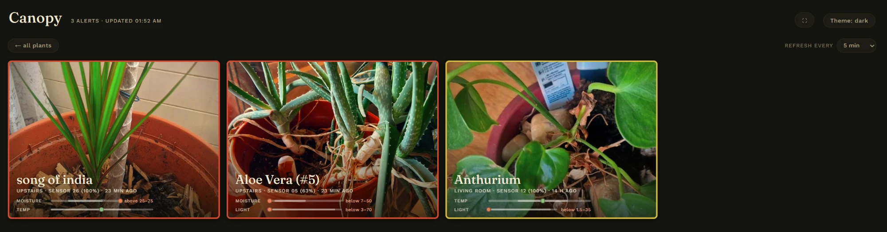
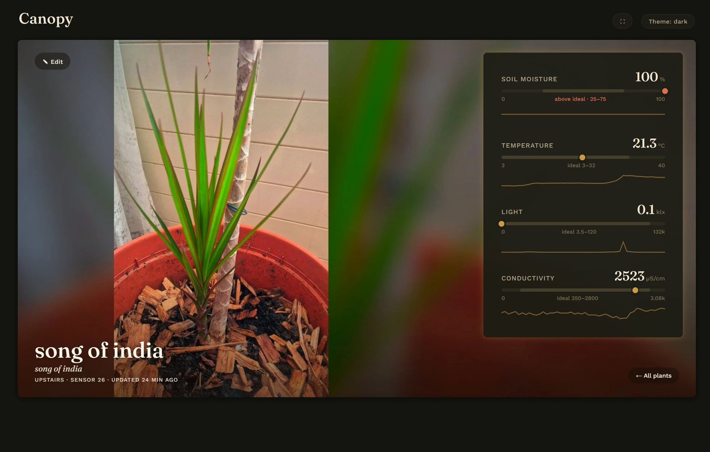
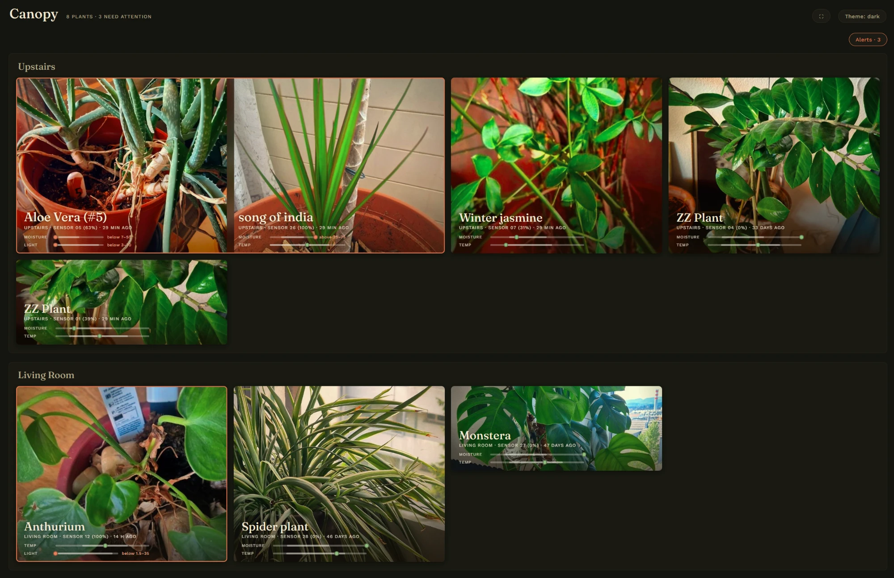
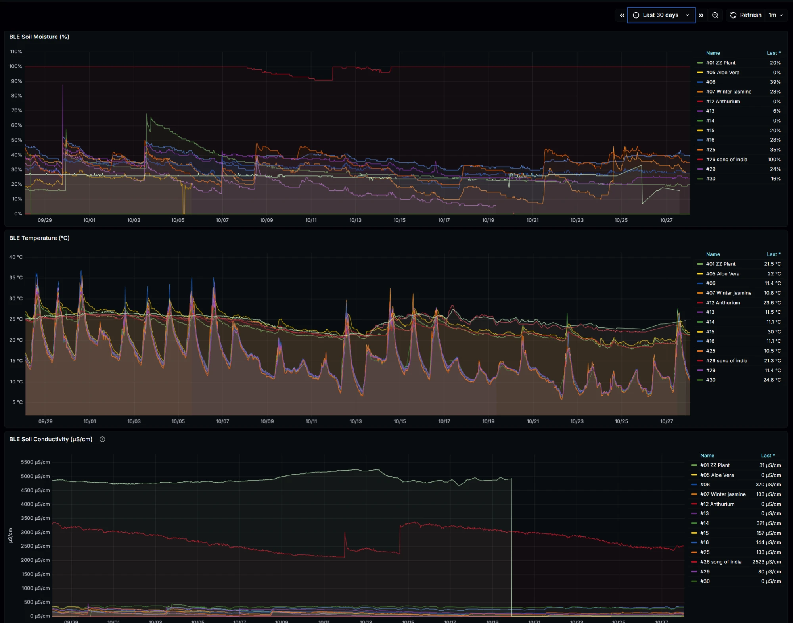

# Canopy

Smart-garden monitoring for houseplants. Xiaomi MiFlora Bluetooth soil sensors report
moisture, temperature, light and fertility; Canopy stores the readings, tells you on
Telegram when plants need attention, and shows everything on a photo-led dashboard.

- **Canopy UI** (port 8090) — your plants as photos, with live metric bars against each
  plant's ideal range, 48-hour sparklines, and in-app photo upload.
- **Grafana** (port 3000) — raw time-series dashboards and sensor-health alerting.
- **Telegram bot** — scheduled digests of what needs water, light or care; admin commands;
  send it a photo of a plant and it identifies the species (optional, needs a free API key).
- **Everything runs on one machine** as a Docker Compose stack: a Raspberry Pi (64-bit OS) is
  the target, any Linux box with Bluetooth works. Notify-only — Canopy never waters anything.

## What it looks like


*Alert board — the plants that currently need attention.*


*Plant detail — each metric against its ideal range, plus recent history.*


*Overview — every plant as a photo, grouped by room.*


*Grafana — raw time series for every sensor.*

## What you need

| | |
|---|---|
| A Linux machine with Bluetooth | A Raspberry Pi running a 64-bit OS, or any 64-bit Linux box, within Bluetooth range of the sensors. |
| Xiaomi MiFlora sensors | The `HHCCJCY01` "Flower Care" model, one per plant, on firmware 3.x. |
| A Telegram account | To create your own bot (two minutes, free). |
| Internet access | For the install and for Telegram. |

## Quick start

On the machine that will host Canopy, run:

```bash
curl -fsSL https://raw.githubusercontent.com/alfarme/canopy/main/install.sh | bash
```

That's the whole install. The script:

1. installs `git` and, if you agree, Docker (if Docker had to be installed, log out and back
   in once and run the same command again);
2. downloads Canopy to `~/canopy`;
3. asks you a few questions — where to keep the data (default `~/canopy-data`), whether to
   change the web ports, and your three Telegram values (below);
4. builds and starts everything, and sets up a nightly database backup (kept 14 days).

The first build takes several minutes on a Pi. When it finishes it prints the addresses of
the dashboards. To watch what it does, use `curl -fsSL <url> | bash -x`; tokens and passwords
are not printed in the trace.

**Prefer not to pipe a script into your shell, or have a custom setup?** Follow
[INSTALL.md](INSTALL.md) to install by hand from a clone of this repository.

### The Telegram values

The installer asks for these; here is where to get them:

1. **Bot token** — in Telegram, message **@BotFather**, send `/newbot`, follow the prompts, and
   copy the token it gives you.
2. **Your user id** — message **@userinfobot**; it replies with your numeric id.
3. **Chat id** — where digests are sent. Press Enter to use your own user id (a private chat
   with the bot). Before that, send your new bot any message so it is allowed to write to you.
   For a group, add the bot and use the group's id (a negative number).

### Optional API keys (after the install)

Two free services make Canopy smarter. Without them it still works, using conservative
default care thresholds.

| Variable in `.env` | Enables | Get it at |
|---|---|---|
| `PLANTNET_API_KEY` | Plant species identification from a photo | my.plantnet.org |
| `OPENPLANTBOOK_CLIENT_ID`, `OPENPLANTBOOK_CLIENT_SECRET` | Species-specific care thresholds | open.plantbook.io |

Add them to `~/canopy/.env`, then apply with:

```bash
~/canopy/install.sh
```

## First run

1. **Wait a few minutes**, then open the Canopy UI at `http://<your-machine>:8090` and Grafana
   at `http://<your-machine>:3000` (user `admin`; the generated password is in
   `<data dir>/env/grafana.env`).
2. **Register your sensors.** Each sensor announces itself in Telegram with a "new sensor"
   alert containing its MAC address. Give it a number with `/addsensor MAC NUMBER`, then
   assign it to a plant with `/assign`. `/help` lists every command.
3. **Nothing arriving?** See [first run on new hardware](docs/technical.md#10-first-run-on-new-hardware)
   for a short checklist.

## Day to day

| | |
|---|---|
| Update to the latest version | `~/canopy/install.sh` (pulls, rebuilds, restarts; your data is kept) |
| Change a setting or key | Edit `~/canopy/.env`, then `~/canopy/install.sh` |
| Logs | `docker logs -f cp-ingest` (also `cp-decision`, `cp-telegram`, `cp-canopy-ui`, `cp-grafana`, `cp-theengs`) |
| Backups | Nightly dumps in `<data dir>/backups`, 14 days kept |

Edit only the single `~/canopy/.env`. The per-container files under `<data dir>/env/` are
regenerated from it on every run.

## Security notes

- The MQTT broker (port 1883) allows anonymous connections and is meant for a trusted home
  network. Do not forward it to the internet.
- The Canopy UI has no login at all, and Grafana is protected only by its admin password.
  Keep both on your LAN, or put them behind a VPN or an authenticating reverse proxy.
- `.env` and `<data dir>/env/*.env` hold your tokens and passwords (mode 600). Never commit them.

## How it fits together

```
MiFlora sensors ──BLE──▶ Theengs Gateway ──▶ MQTT ──▶ ingest ──▶ TimescaleDB
                                                                    │
                                          ┌─────────────────────────┼───────────────┐
                                          ▼                         ▼               ▼
                                   decision-engine              Grafana        Canopy UI
                                     (digests)
                                          ▼
                                    Telegram bot
```

Services live in `services/` (`ingest`, `decision-engine`, `telegram-bot`, `canopy-ui`);
infrastructure config is in `compose/`.

## For contributors

- `docs/technical.md` — design rationale, operations, and a from-scratch rebuild guide.
- `docs/changelog.md` — what changed, newest first.
